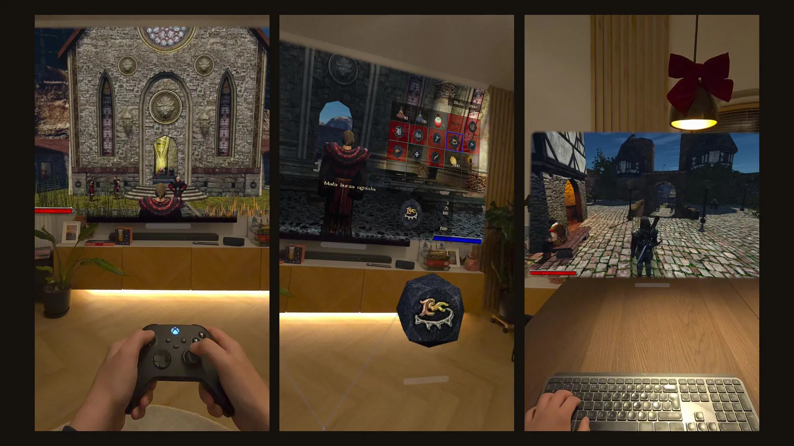
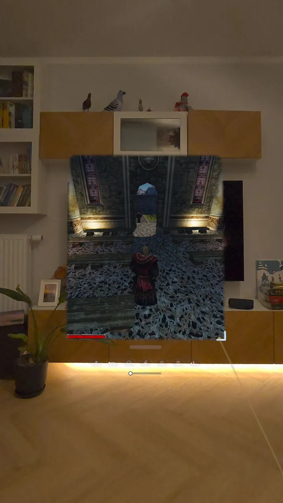
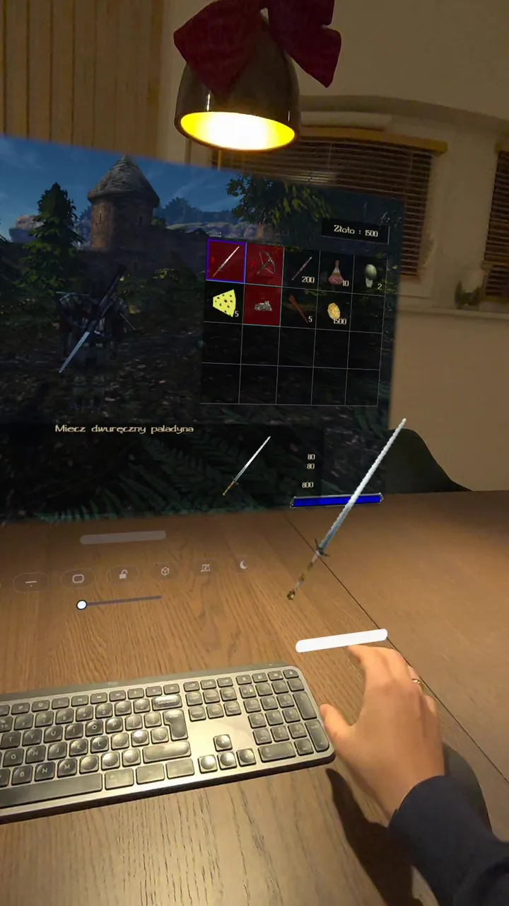
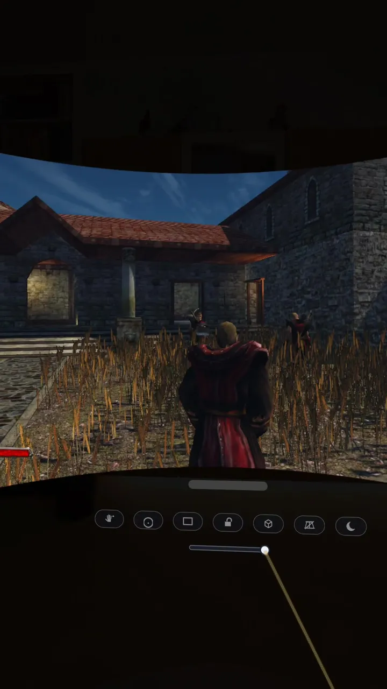

# Gothic II in 3D on Meta Quest

> Forked from **[OpenGothic](https://github.com/Try/OpenGothic)**, the open-source Gothic II engine
> by Try and contributors. This fork adds a Meta Quest version; the desktop OpenGothic README is
> kept in [docs/OpenGothic.md](docs/OpenGothic.md).

**Play Gothic II: Night of the Raven on your Meta Quest, through a 3D window floating in your room.**



The game runs on the headset itself, with no PC needed while you play. You see Khorinis through a
life-size, head-tracked stereo window: lean in and the world behind it shifts with real depth, as
if it were an actual window in your wall. Move it, resize it, curve it, and play with a keyboard
and mouse, a gamepad or the Quest controllers.

**Project page, videos and news: [kwrona.com/gothic2-3d](https://kwrona.com/gothic2-3d)**

**No game data is included.** You need your own copy of *Gothic II Gold Edition* (Gothic II +
Night of the Raven) from [Steam](https://store.steampowered.com/app/39510/) or
[GOG](https://www.gog.com/game/gothic_2_gold_edition).

---

## What you need

- **Meta Quest 3 or 3S.** Developed and tested on Quest 3. Quest 2 and Pro may install, but are
  untested.
- **A Windows PC** with **Gothic II Gold Edition** installed, used once to install the app and copy
  the game files to the headset.
- **A USB cable** that connects the headset to the PC (the charging cable works if it carries data).
- About **3.5 GB free** on the headset.
- Optional: a Bluetooth keyboard and mouse or an Xbox-style controller. The Quest controllers
  work too.

## Install

### 1. Turn on developer mode (once)

Apps from outside the Meta store need developer mode. It is free.

1. Create a developer organization at
   [developers.meta.com](https://developers.meta.com/horizon/manage/organizations/create/), signed
   in with the same Meta account as your headset. Any name works.
2. In the **Meta Horizon** app on your phone: **Menu → Devices →** your headset **→ Headset
   settings → Developer mode**, and turn it on.
3. Restart the headset.

### 2. Run the installer

1. Download **`OpenGothicWindow3D-Quest-Installer.exe`** from the
   [latest release](https://github.com/krzychuwr1/OpenGothicWindow3D/releases/latest). It is the
   only file you need: the app and the tools to install it are inside.
2. Connect the headset to the PC with the USB cable. Put the headset on and choose **Allow** when it
   asks to allow USB debugging (tick *Always allow from this computer*).
3. Run the installer. If Windows SmartScreen warns about an unknown program, choose
   **More info → Run anyway**.
4. Check both sections:
   - **1. Gothic II Installation:** it finds Steam and GOG copies by itself. Otherwise click
     **Browse...** and pick the folder that contains `Data`, `_work` and `System`.
   - **2. Meta Quest Headset:** should say *Connected*.
5. Click **Install to Quest**. Copying the game files (about 3 GB) takes a few minutes.

### 3. Start the game

On the headset open the **Library**, switch the filter to **Unknown Sources** and start
**OpenGothic Window3D**. Or click **Launch on Quest** in the installer.

### Other Android OpenXR headsets (advanced)

The app is made and tested on Meta Quest. Other standalone Android headsets with an OpenXR
runtime and Vulkan may work, but are untested. Tick **Advanced (other headsets)** in the
installer to get:

- **Device:** any Android device that adb sees, not only a Quest.
- **Wireless adb:** for headsets without USB debugging. In the headset's wireless debugging
  settings, choose to pair with a code, enter that address and code and click **Pair**. Then
  enter the address shown on the wireless debugging screen itself and click **Connect**.
- **Game files to:** the shared `/sdcard/OpenGothic` folder, which needs all-files access (the
  installer grants it over adb), or the app's own folder, which needs no permission but is
  deleted with the app. Meta Quest only works with the shared folder.
- **Install the app:** untick it to copy only the game files, for example after installing
  the APK another way.
- **Save APK...:** saves `OpenGothicWindow3D.apk` with no headset connected, for installing with
  the headset's own tools. Then copy `Data`, `_work` and `System` from your Gothic II folder to
  `/sdcard/OpenGothic/Gothic2` (and allow the app *All files access* in the headset's settings), or
  to `/sdcard/Android/data/org.opengothic.window3d/files/Gothic2`.
- **Save copy script...:** saves ready-to-run `copy-game-files.bat` (Windows) and
  `copy-game-files.sh` (Linux/SteamOS) scripts with the selected game folder and target location
  baked in, to push `Data`, `_work` and `System` over `adb` later.

## Setting up

**Controls.** Pair a Bluetooth keyboard and mouse or gamepad in the headset's
**Settings → Bluetooth** before starting the game. Keyboard and mouse use the standard Gothic II
keys. With a gamepad or the Quest controllers, the left stick moves, the right stick turns, the
right trigger attacks, **A** jumps, **B** draws your weapon and **X** opens the inventory.
[Full controls](android/quest/README.md#controls).

**Placing the window.** The window opens in front of you. Point at the **handle** under the window
and pinch (hands) or squeeze grip (controllers) to move it. Grab a **bottom corner** to resize it.
Hold the **Meta button** to bring it back in front of you.

**Window buttons.** Point at the handle and a row of buttons appears under it:

| Button | What it does |
| --- | --- |
| Hands | Show your hands as outlines with pointer rays: off, automatic or always |
| Curve | Curve the window around you like a curved monitor |
| Edges | Square, rounded or soft window edges |
| Padlock | Keep the window's shape while resizing |
| Cube | Show the selected inventory item as a 3D object outside the window |
| Surface light | Let the game's light fall on your table or floor (experimental) |
| Moon / window | Switch between your room (passthrough) and a dusk VR landscape |
| Slider | Dim the room around the window |

| Hang it on a wall | Items in 3D | Curved, in the VR landscape |
| :---: | :---: | :---: |
|  |  |  |

**Graphics.** The Quest version starts with lighter settings than the PC version. In the game's
**Settings → Video settings** you can change the refresh rate, try **Application SpaceWarp**
(smoother motion at half the rendering cost; experimental) and **Foveation** (cheaper lighting at
the edges of your view).

## Updating and uninstalling

- **Update:** download the new installer and run it. Tick *Update app only* to skip copying the
  game files again. Your saves and settings are kept.
- **Uninstall:** in the headset's Library, open the app's **···** menu and choose **Uninstall**.
  This also removes saves and settings. The game files stay in `/sdcard/OpenGothic`; delete that
  folder (for example with a file manager app on the headset) to free the space.

## Troubleshooting

- **The installer says "No Quest detected".** Check that developer mode is on, try another USB
  cable or port, and look in the headset for the *Allow USB debugging* prompt.
- **"Headset detected — put it on and allow USB debugging".** The headset is waiting for you to
  allow USB debugging. Put it on and choose **Allow**.
- **"An Android device is connected, but no Quest".** The simple mode only installs to a Quest.
  For another headset, tick **Advanced (other headsets)**.
- **Gothic II is not found.** Click **Browse...** and select the game folder, the one that contains
  `Data`, `_work` and `System`. The original *Gothic II* without *Night of the Raven* is not
  enough: you need the Gold Edition.
- **The app is not in the Library.** Set the Library filter to **Unknown Sources**.
- **Something else.** [Open an issue](https://github.com/krzychuwr1/OpenGothicWindow3D/issues),
  and say which headset you use and what happened.

## Building from source

For developers. The build runs on Windows:

```powershell
git clone --recursive -c core.longpaths=true https://github.com/krzychuwr1/OpenGothicWindow3D.git
cd OpenGothicWindow3D
./tools/fetch-quest-deps.ps1
./tools/build-quest.ps1 -Install
```

Requirements (Android SDK and NDK, CMake, Ninja, Python, glslangValidator), developer options and
the Polish package variant are described in the [Quest guide](android/quest/README.md#build-from-source).

## Credits and license

Built on [OpenGothic](https://github.com/Try/OpenGothic) by Try and contributors, with
[Tempest](https://github.com/Try/Tempest), [ZenKit](https://github.com/GothicKit/ZenKit),
[dmusic](https://github.com/GothicKit/dmusic), [Bullet](https://github.com/bulletphysics/bullet3)
and the [OpenXR loader](https://github.com/KhronosGroup/OpenXR-SDK). Released under the
[MIT License](LICENSE), like OpenGothic.

This is an unofficial fan project. It is not affiliated with or endorsed by THQ Nordic, Piranha
Bytes or Meta. Gothic is a trademark of its respective owners.
